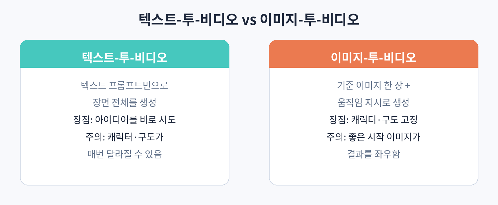

# Part 2. 프롬프트로 영상 만들기

## 20. 텍스트-투-비디오와 이미지-투-비디오의 차이

영상 생성 AI의 입력 방식은 크게 두 가지다. 텍스트만으로 만드는 텍스트-투-비디오, 기준 이미지 한 장에 움직임 지시를 더하는 이미지-투-비디오다. 둘의 차이를 이해하는 것이 모든 작업의 출발점이다.

### 텍스트-투-비디오

프롬프트 한 줄로 장면 전체를 만든다. 장점은 속도와 자유도다. 아이디어가 떠오르면 바로 시도해 볼 수 있고, 존재하지 않는 장소나 상황을 만들 수 있다. 단점은 통제하기 어렵다는 점이다. 같은 프롬프트로 여러 번 만들면 인물의 얼굴, 옷, 배경이 매번 조금씩 달라진다. 단발성 클립이나 분위기 위주의 영상에는 충분하지만, 같은 캐릭터가 계속 나와야 하는 시리즈에는 불리하다.

### 이미지-투-비디오

기준 이미지를 먼저 만들고, 그 이미지에 "어떻게 움직일지"를 지시한다. 이미지 생성 AI로 만든 스틸 이미지, 직접 찍은 사진, 일러스트 모두 기준이 될 수 있다. 장점은 일관성이다. 캐릭터의 얼굴과 옷, 배경의 구도가 이미지에서 고정되므로 여러 클립을 만들어도 같은 세계처럼 보인다. 단점은 시작 이미지의 품질이 결과를 좌우한다는 점이다. 어색한 이미지를 넣으면 어색한 영상이 나온다.

### 실무에서의 선택

정답은 "둘 다 쓴다"이다. 일반적인 순서는 이렇다. 먼저 텍스트-투-비디오로 여러 장면을 빠르게 시도해 보고, 마음에 드는 장면이 나오면 그 프레임을 캡처하거나 비슷한 이미지를 별도로 만든다. 그 다음 이미지-투-비디오로 같은 세계관의 클립들을 양산한다. 시리즈물의 캐릭터는 이미지 생성 단계에서 확정하고, 이후에는 이미지-투-비디오만 쓰는 것이 효율적이다.

### 실습: 같은 장면을 두 방식으로 만들기

주제를 하나 정하자. "비 오는 밤, 네온사인이 비치는 골목을 걷는 사람" 같은 것이다. 먼저 텍스트-투-비디오로 다섯 번 생성해 본다. 다섯 개의 결과가 얼마나 다른지 확인한다. 그 중 가장 마음에 드는 것의 첫 프레임을 기준으로 삼아, 이미지 생성 AI로 비슷한 구도의 이미지를 만든 뒤 이미지-투-비디오로 다섯 번 생성해 본다. 두 방식의 결과물 차이를 눈으로 확인하는 것이 이 장의 실습이다.
