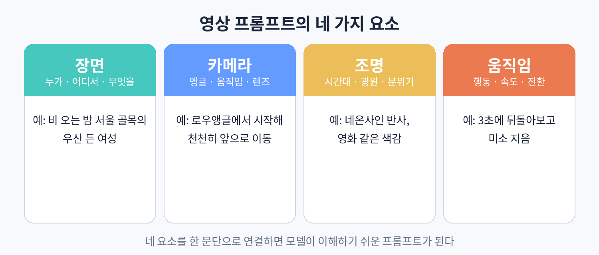

# 21. 프롬프트 작성법: 장면, 카메라, 조명, 움직임

영상 프롬프트는 사진 프롬프트에 "시간"을 더한 것이다. 정적인 장면 설명에 카메라의 움직임과 피사체의 행동, 그 타이밍을 지정해야 한다. 이 장에서는 프롬프트를 네 가지 요소로 나누어 작성하는 방법을 설명한다.

### 요소 1. 장면: 누가, 어디서, 무엇을

장면은 프롬프트의 뼈대다. 주인공이 누구인지, 어디에 있는지, 무엇을 하고 있는지를 구체적으로 적는다. "여자"보다는 "검은 단발머리에 베이지색 트렌치코트를 입은 20대 여성"이 낫다. 장소도 "카페"보다는 "비 오는 날 창가에 앉을 수 있는 작은 동네 카페"가 낫다. 구체적일수록 모델이 엉뚱한 해석을 할 여지가 줄어든다.

### 요소 2. 카메라: 앵글, 움직임, 렌즈

카메라 지시는 영상을 "영상답게" 만드는 핵심이다. 앵글(로우앵글, 아이레벨, 하이앵글, 드론샷), 움직임(천천히 앞으로 이동, 좌우로 패닝, 피사체를 따라 회전), 렌즈감(얕은 심도, 광각의 왜곡)을 지정한다. 카메라가 가만히 있는 클립과 움직이는 클립은 시청자가 느끼는 몰입도가 확연히 다르다. 매 클립마다 카메라 움직임을 하나씩은 넣는 습관을 들이자.

### 요소 3. 조명: 시간대, 광원, 분위기

조명은 분위기를 결정한다. 시간대(새벽, 황혼, 한밤중), 광원(창문으로 들어오는 자연광, 네온사인, 가로등), 색감(따뜻한 톤, 차가운 톤, 영화 같은 콘트라스트)을 지정한다. 같은 장면이라도 조명 지시 하나에 완전히 다른 영상이 된다. "시네마틱한 색감" 같은 추상적인 말보다 "주황색 가로등 불빛이 얼굴 한쪽을 비추는" 같은 구체적인 묘사가 효과적이다.

### 요소 4. 움직임: 행동, 속도, 전환

피사체가 무엇을 하는지, 얼마나 빠르게 하는지, 클립 안에서 어떤 변화가 일어나는지를 적는다. "걷는다"보다는 "3초 동안 천천히 걸어오다가 카메라를 보고 멈춰 선다"가 낫다. 움직임이 클수록 모델이 어색하게 만들 확률이 올라가므로, 처음에는 작고 분명한 움직임부터 시도하고 점점 복잡하게 만드는 것이 요령이다.

### 네 요소를 연결하는 문장

네 요소를 나열식으로 붙이기보다 한 문단으로 자연스럽게 연결하면 모델이 이해하기 쉽다. 예를 들면 다음과 같은 형태다.

"비 오는 밤 서울의 좁은 골목. 검은 단발머리에 베이지색 트렌치코트를 입은 20대 여성이 우산을 쓰고 걸어온다. 카메라는 로우앵글에서 시작해 천천히 앞으로 이동하며 그녀를 따라간다. 네온사인 불빛이 젖은 아스팔트에 반사되고, 영화 같은 차가운 색감이다. 3초쯤 지나 그녀가 걸음을 멈추고 카메라를 향해 돌아보며 옅은 미소를 짓는다."

길이는 이 정도가 적당하다. 너무 짧으면 모델이 멋대로 채우고, 너무 길면 핵심 지시가 묻힌다. 처음에는 네 요소를 의식적으로 챙겨 쓰고, 익숙해지면 자연스럽게 섞어 쓰면 된다.
