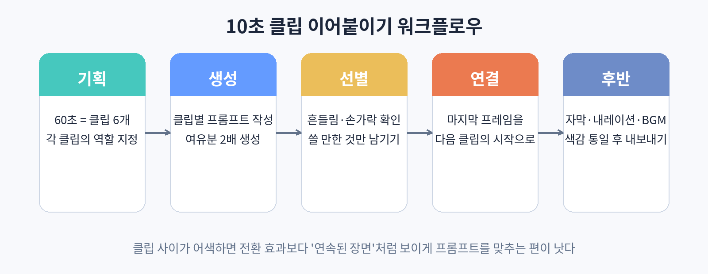

# Part 3. 클립을 이어 붙이는 실무

## 30. 10초 클립 이어붙이기 워크플로우

AI 영상 제작의 현실은 이렇다. 한 번에 만들 수 있는 클립은 10초 안팎이고, 시청자가 원하는 영상은 1분이다. 결국 10초짜리 클립 6개를 이어 붙여 1분을 만드는 것이 이 책의 핵심 기술이다. 클립을 잇는 과정을 워크플로우로 정리해 두면 매번 헤매지 않는다.

### 1단계. 기획: 클립별 역할 지정

60초 영상을 6개 클립으로 나눈다고 해서 6개를 똑같이 만들면 안 된다. 각 클립에 역할을 준다. 예를 들어 드라마라면 1번 클립은 훅(충격적인 첫 장면), 2~4번은 전개, 5번은 반전의 조짐, 6번은 반전과 여운이다. 각 클립의 프롬프트를 쓰기 전에 "이 클립에서 시청자에게 보여 줄 것은 무엇인가"를 한 줄로 적는다. 이 한 줄이 없으면 클립들이 따로 논다.

### 2단계. 생성: 여유분까지 만든다

클립별로 프롬프트를 작성해 생성한다. 중요한 것은 여유분이다. 필요한 것의 2배 정도를 만든다. 6개가 필요하면 12개를 만든다는 뜻이다. 어차피 절반은 흔들림, 어색한 손, 갑자기 바뀌는 배경 때문에 버리게 된다. 여유분 없이 딱 맞게 만들면, 버릴 클립이 생겼을 때 처음부터 다시 생성해야 한다.

### 3단계. 선별: 버릴 기준을 정한다

만든 클립을 전수 검사한다. 버리는 기준은 세 가지다. 인물의 얼굴이나 손이 어색하게 일그러진 것, 배경이나 옷이 클립 안에서 갑자기 바뀌는 것, 움직임이 부자연스럽게 끊기는 것이다. 애매한 클립은 과감히 버린다. 10초 클립 하나가 전체 영상의 신뢰도를 떨어뜨린다.

### 4단계. 연결: 마지막 프레임을 잇는다

클립 사이의 어색함을 줄이는 가장 확실한 방법은 "연속된 장면"처럼 만드는 것이다. 이전 클립의 마지막 프레임과 비슷한 구도로 다음 클립을 시작하게 프롬프트를 맞춘다. 예를 들어 1번 클립이 "여자가 문을 열고 들어오는 장면"으로 끝난다면, 2번 클립은 "문이 열린 실내에서 여자가 들어오는 장면"으로 시작한다. 이미지-투-비디오를 쓴다면 이전 클립의 마지막 프레임을 캡처해 다음 클립의 기준 이미지로 쓰는 방법도 있다.

전환 효과를 남발하지 않는 편이 좋다. 페이드나 화면 전환을 많이 쓰면 오히려 "이어 붙인 티"가 난다. 자연스럽게 이어지는 것이 최선이고, 어쩔 수 없을 때만 최소한의 전환을 쓴다.

### 5단계. 후반: 자막, 내레이션, 음악

클립이 다 이어지면 자막과 내레이션, 배경음악을 입힌다. 이때 클립들의 색감이 들쭉날쭉하면 간단한 색보정으로 통일한다. 대부분의 편집 도구에서 제공하는 자동 색상 맞춤 기능이면 충분하다. 마지막으로 9:16 세로 규격으로 내보내기 전에, 중요 요소가 화면 중앙에 들어오는지 확인한다.

### 실습: 30초 영상 만들기

주제를 하나 정하고 10초 클립 3개로 30초짜리 영상을 만들어 본다. 기획-생성-선별-연결-후반의 다섯 단계를 전부 거쳐 본다. 60초가 부담스럽다면 30초부터 시작하자. 세 클립이 자연스럽게 이어지는지만 확인해도 이 장의 목표는 달성한 것이다.
