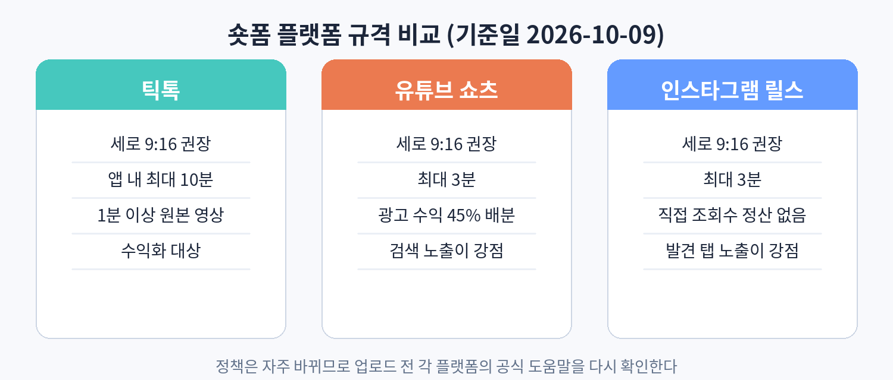

# Part 4. 숏폼 플랫폼 전략

## 40. 틱톡, 쇼츠, 릴스 규격 비교

영상을 만들었으면 어디에 올릴지 정해야 한다. 플랫폼마다 규격과 알고리즘이 다르고, 같은 영상이라도 어디에 올리느냐에 따라 결과가 달라진다. 기준일 2026년 10월 9일 현재의 규격을 정리한다. 정책은 자주 바뀌므로 업로드 전에 공식 도움말을 다시 확인하자.

### 공통 규격

세 플랫폼 모두 세로 9:16을 표준으로 쓴다. 1080x1920 해상도로 만들면 어디에 올려도 무방하다. 가로 영상을 세로에 억지로 넣으면 몰입도가 떨어지므로, 기획 단계부터 세로 화면을 기준으로 구도를 잡는다.

### 틱톡

숏폼의 원조 격인 플랫폼이다. 앱 내에서 만들 수 있는 영상 길이가 길고(최대 10분), 업로드로는 그 이상도 가능하다. 트렌딩 사운드와 챌린지 문화가 강해 바이럴 확산 속도가 빠르다. 신규 계정도 알고리즘 추천을 받을 기회가 있어 초기 성장에 유리하다. 수익화는 크리에이터 리워드 프로그램을 통해 이루어지며, 일정 조건(나이, 팔로워 수, 조회수)을 충족해야 하고 1분 이상의 원본 영상이 대상이다.

### 유튜브 쇼츠

최대 길이는 3분이다. 강점은 검색이다. 틱톡과 릴스가 추천 피드 중심이라 영상의 수명이 짧은 편인 반면, 쇼츠는 유튜브 검색에 노출되어 오래 조회수를 만든다. 정보성 콘텐츠, 시리즈물의 아카이빙에 유리하다. 유튜브 파트너 프로그램 조건(구독자 수, 조회수)을 충족하면 광고 수익을 배분받는데, 쇼츠는 전체 수익의 45%를 크리에이터가 가져가는 구조다.

### 인스타그램 릴스

최대 길이는 3분이다. 인스타그램의 발견 탭과 탐색 탭을 통한 노출이 강점이고, 기존 인스타그램 팔로워가 있다면 시작이 수월하다. 직접적인 조회수 정산은 없고, 수익은 주로 협찬과 브랜드 딜에서 나온다. 비주얼 중심의 라이프스타일, 패션, 여행 콘텐츠가 강세다.

### 어디에 먼저 올릴 것인가

하나만 고를 필요는 없다. 같은 영상을 세 플랫폼에 모두 올리는 크로스포스팅이 일반적이다. 다만 우선순위는 정하자. 빠른 확산을 노리면 틱톡, 검색 유입과 장기 수익을 노리면 쇼츠, 기존 인스타그램 자산이 있으면 릴스다. 처음에는 한 플랫폼에 집중해 반응을 보고, 형식이 자리 잡히면 다른 플랫폼으로 확장하는 순서가 효율적이다. 플랫폼별로 자막 위치와 해시태그 문화가 다르므로, 그대로 복사해서 올리기보다 각 플랫폼에 맞게 미세 조정한다.
