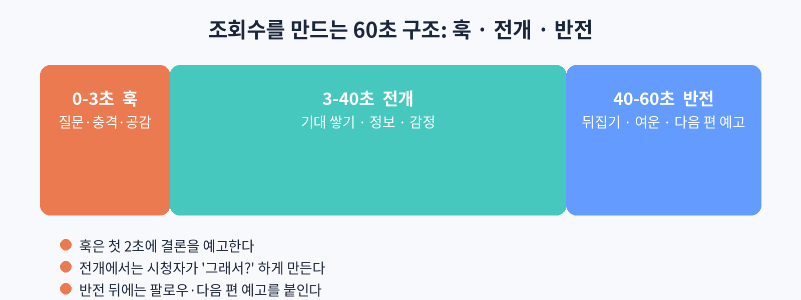

# 42. 조회수를 만드는 기획: 훅, 전개, 반전

숏폼에서 기획은 "무슨 이야기를 할 것인가"가 아니라 "시청자의 손가락을 어떻게 멈추게 할 것인가"의 문제다. 60초 영상의 구조를 훅, 전개, 반전의 세 단계로 나누어 설명한다.

### 0~3초. 훅: 멈추게 한다

훅의 임무는 하나다. 스크롤하던 손가락을 멈추게 하는 것. 방법은 세 가지다. 질문을 던진다("이 영상이 AI로 만들어졌다는 걸 믿겠어요?"). 충격을 준다(가장 강렬한 장면을 먼저 보여 준다). 공감을 건다(시청자의 고민을 말해 준다). 무엇을 쓰든 첫 2초 안에 "이 영상을 볼 이유"를 줘야 한다. 인트로 로고나 "안녕하세요" 같은 인사는 훅을 죽인다. 바로 본론으로 들어간다.

### 3~40초. 전개: 붙잡아 둔다

전개는 시청자가 "그래서 어떻게 되는데?" 하게 만드는 구간이다. 정보를 조금씩 풀고, 감정을 쌓고, 기대를 키운다. 이 구간에서 이탈이 많다면 원인이 둘 중 하나다. 이야기가 지지부진하거나, 다음 장면을 예측할 수 있게 뻔하다. 전개에서는 궁금증을 유지해야 한다. 답을 다 주지 말고, 다음 장면을 보게 만드는 떡밥을 던진다.

### 40~60초. 반전: 기억에 남긴다

반전은 기대를 뒤집는 한 방이다. 반전이 없어도 되는 영상도 있지만, 반전이 있는 영상은 공유와 저장이 늘어난다. 반전의 종류는 여러 가지다. 예상 밖의 결말, 감동적인 반전, 웃음을 주는 뒤집기, 다음 편에 대한 예고. 시리즈물에서는 "다음 편 예고" 자체가 반전 역할을 한다. 시청자가 "다음 편이 궁금해서" 팔로우를 누르게 만드는 것이다.

### 시리즈 구조의 힘

단발성 영상은 매번 처음부터 시청자를 설득해야 한다. 시리즈는 다르다. 한 번 빠진 시청자는 다음 편을 기다린다. 조회수보다 팔로우 증가율이 중요해지는 이유다. 시리즈를 기획할 때는 전체 아크(큰 이야기 흐름)를 먼저 잡고, 각 편에 작은 훅과 반전을 배치한다. 각 편이 독립적으로도 재미있되, 이어 보면 더 재미있는 구조가 이상적이다.

### 실습: 60초 콘티 쓰기

주제 하나를 정하고 60초 콘티를 써 본다. 0~3초의 훅 문장, 3~40초의 전개 흐름, 40~60초의 반전을 각각 한 줄씩 적는다. 콘티가 서면 각 구간을 10초 클립으로 나누어 프롬프트를 작성한다. 기획이 탄탄하면 제작은 생각보다 빨리 끝난다.
