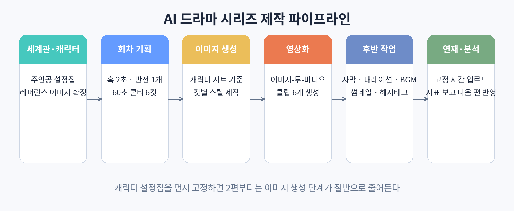

# 60. 실전 프로젝트: AI 드라마 파일럿 1편 제작

이 책에서 배운 내용을 전부 써서 AI 드라마 파일럿 1편을 만들어 본다. 기획부터 업로드까지의 전 과정을 순서대로 따라간다.

### 1단계. 기획서 작성

먼저 기획서를 쓴다. 예시로 복수극 파일럿을 잡아 보자.

제목: 가제 "돌아온 그녀"
장르: 복수극
주인공: 20대 여성, 검은 단발머리, 베이지색 트렌치코트가 트레이드마크. 5년 전 배신당한 뒤 이름을 바꾸고 돌아왔다.
60초 콘티:
0~3초 훅: "5년 만에 돌아온 그녀가 가장 먼저 찾아간 곳은, 자신을 배신한 남자의 결혼식장이었다." (자막과 내레이션으로)
3~40초 전개: 결혼식장 앞, 우산을 쓴 그녀의 뒷모습. 하객들 사이로 보이는 남자의 얼굴. 그녀가 천천히 걸어간다.
40~60초 반전: 그녀가 우산을 접는다. 카메라가 얼굴을 비추자, 남자가 하객석에서 얼어붙는다. 자막: "다음 편: 그녀의 첫 번째 복수"
다음 편 예고: "2편에서 밝혀지는 그녀의 계획"

### 2단계. 캐릭터 설정과 기준 이미지

주인공의 외모 설명 문구를 확정해 파일로 저장한다. "검은 단발머리, 20대 동양인 여성, 베이지색 트렌치코트, 차분한 표정" 같은 식이다. 이미지 생성 AI로 정면·측면·전신 이미지를 만들고 마스터 이미지 한 장을 정한다.

### 3단계. 클립 생성

60초를 10초 클립 6개로 나눈다. 각 클립의 역할을 콘티에 따라 지정하고 프롬프트를 작성한다. 캐릭터가 나오는 클립은 마스터 이미지를 기준으로 이미지-투-비디오로 만든다. 클립당 2개씩, 총 12개를 만들어 선별한다.

클립별 프롬프트 예시(1번 클립, 훅):
"밤, 비 오는 결혼식장 앞. 검은 단발머리에 베이지색 트렌치코트를 입은 여성이 검은 우산을 쓰고 서 있다. 카메라는 뒤에서 천천히 다가간다. 가로등 불빛이 젖은 아스팔트에 반사되고, 긴장감 있는 차가운 색감. 그녀가 우산을 살짝 들어 올린다."

### 4단계. 후반 작업

클립 6개를 이어 붙인다. 내레이션 대본을 쓰고 TTS로 음성을 만든다. 훅 문장과 반전 자막을 강조 스타일로 입힌다. 배경음악은 긴장감 있는 곡을 플랫폼 음원 라이브러리에서 고른다. 색감을 통일하고 1080x1920으로 내보낸다.

### 5단계. 업로드와 다음 편

제목, 설명글, 해시태그를 준비한다. 고유 태그(예: 돌아온그녀)를 만들어 회차를 묶는다. 고정 요일에 업로드한다. 댓글 반응을 보고 2편의 전개를 조정한다.

### 완성 기준

이 프로젝트의 완성 기준은 "1편을 실제로 업로드하는 것"이다. 완벽한 1편보다 일단 나온 1편이 낫다. 1편의 데이터(3초 이탈율, 완주율, 팔로우 전환율)를 보고 2편을 개선하는 것이 시리즈 운영의 본질이다. 책을 덮기 전에 기획서 한 장과 클립 여섯 개를 만들어 보자.
